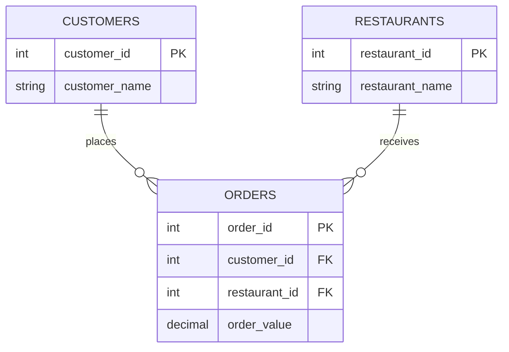

# 🍔 FOOD DELIVERY — SQL CASE FILE
### Day 01 · Restaurant orders and customer activity

## Case snapshot
| Customers | Orders | Ordered customers | No-order customers |
|---:|---:|---:|---:|
| 10 | 10 | 8 | 2 |

## Revenue desk
| Measure | Finding |
|---|---:|
| Total order value | 6,620 |
| Average order value | 662 |
| Top restaurant | Meghana Foods |
| Orders at top restaurant | 3 |

## Entity relationship sketch

## Investigation steps
1. Inspect customer and order tables.
2. Join customers to orders.
3. Find customers without a matching order.
4. Aggregate order value by restaurant.
5. Compare outputs with the assignment PDF.

## Evidence files
- [SQL script](Day-01-SQL-Food-Delivery-Analysis.sql)
- [Original challenge PDF](Coding%20Challenge-Day%201.pdf)

> The SQL workflow drops and recreates only Orders and Customers in the DAY1 database. Use a disposable practice database.

These figures come from a small assignment dataset, not a live food-delivery business.