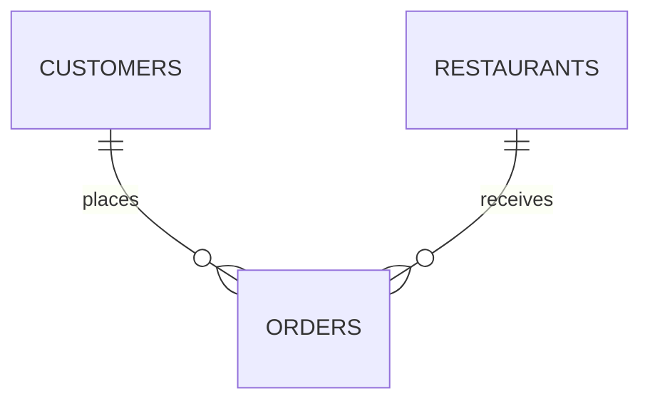

<h1>🍔 ORDER DESK / FOOD DELIVERY</h1>
DAY 01 · SQL CASE STUDY

## Daily operations snapshot
<table><tr><td align="center"><h1>10</h1>customers</td><td align="center"><h1>10</h1>orders</td><td align="center"><h1>8</h1>ordered</td><td align="center"><h1>2</h1>no order</td></tr></table>

## Restaurant sales board
| INDICATOR | RESULT |
|---|---:|
| Total order value | 6,620 |
| Average order value | 662 |
| Top restaurant | Meghana Foods |
| Orders at top restaurant | 3 |

## Data relationship sketch

## SQL investigation route
`CUSTOMERS + ORDERS → JOIN → FIND NON-ORDERING CUSTOMERS → GROUP BY RESTAURANT → SUM ORDER VALUE`

## Project files
- [SQL script](Day-01-SQL-Food-Delivery-Analysis.sql)
- [Challenge PDF](Coding%20Challenge-Day%201.pdf)

> The SQL workflow drops and recreates only Orders and Customers in the DAY1 database. Use a disposable practice database.

Small assignment dataset; not a live food-delivery operating report.