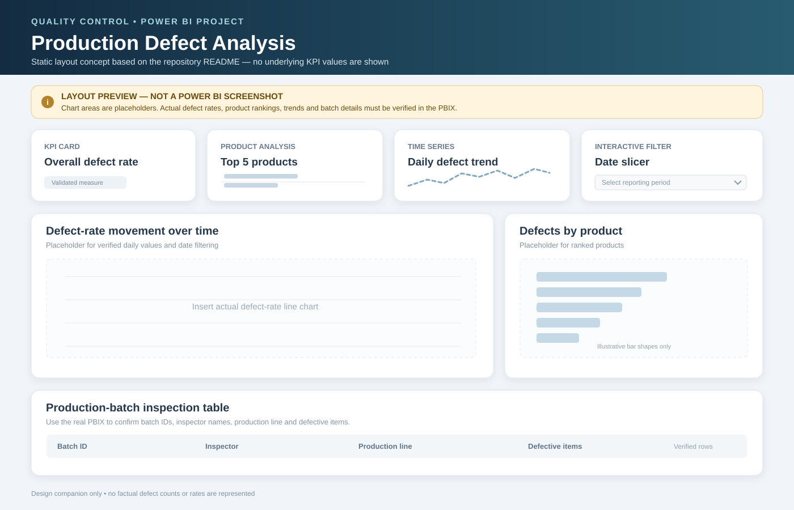

# 🏭 QUALITY CONTROL — INSPECTION BOARD
### Day 03 · Manufacturing defect analysis · Power BI

## Conceptual dashboard preview

Conceptual SVG preview only—not an exported Power BI screenshot.

## Inspection panels
| Panel | Intended question |
|---|---|
| Defect overview | Which defect measures are available? |
| Defect category | Which defect types can be compared? |
| Production context | How do defects relate to production volume? |
| Time pattern | Are there changes over time? |
| Quality action | Which areas merit investigation? |

## Deliverables
| Asset | Purpose |
|---|---|
| [Power BI report](Quality_Control_Defect_Analysis.pbix) | Interactive report file |
| [Assignment PDF](Day3-Quality%20Control.pdf) | Original task brief |
| [Layout preview](screenshots/defect-analysis-layout-preview.svg) | Static design concept |

## Evidence status
Repository includes the PBIX, PDF and one SVG preview. No verified defect-rate figures or genuine Power BI screenshot exports are documented here. Inspect the PBIX and validate fields, measures and filters before reporting numerical conclusions.

## Analyst sign-off
- [ ] Confirm production denominator.
- [ ] Validate defect counts and definitions.
- [ ] Check date filters and categories.
- [ ] Reconcile KPI cards to source rows.
- [ ] Capture genuine report screenshots.

Do not infer defect rates, trends or process causes from the conceptual image.