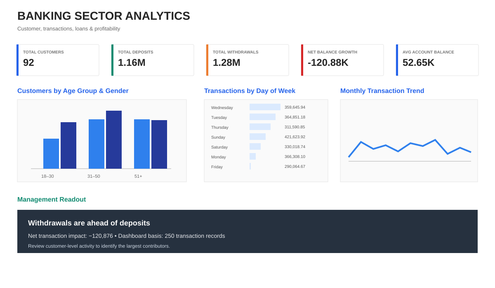
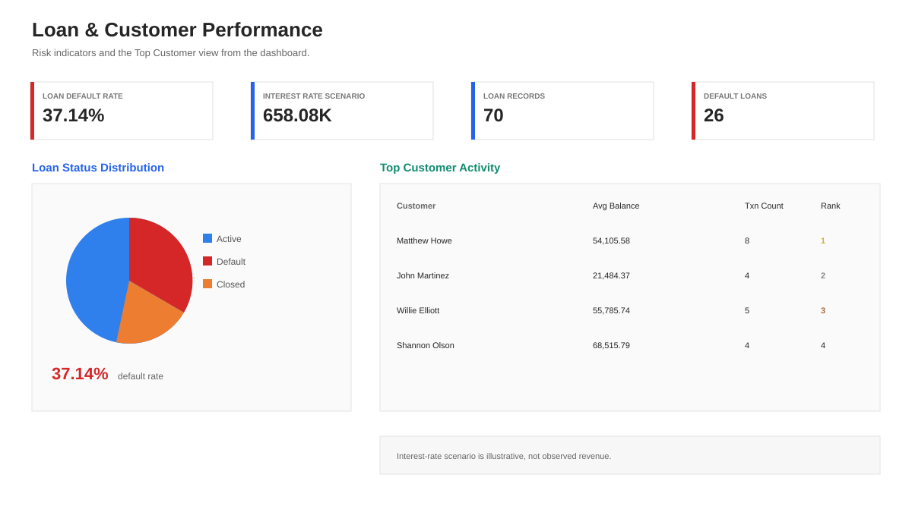
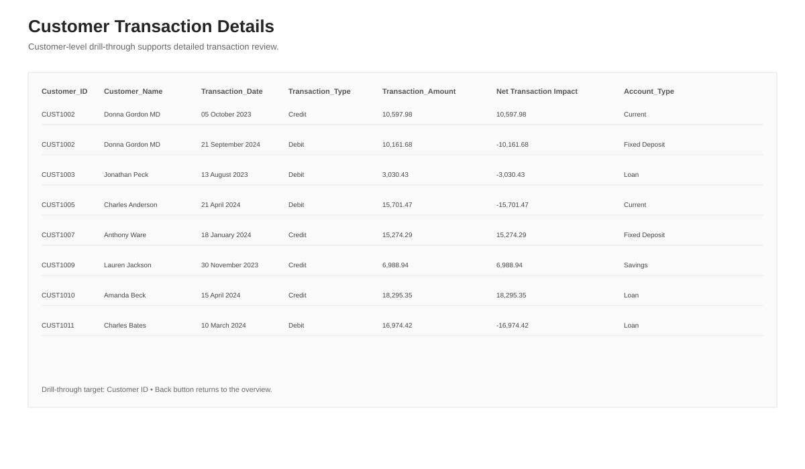

# Banking Sector Analytics | Power BI

<p align="center">
  
</p>

<p align="center">
  
  
  
  
</p>

## 1. Project Overview

Banking Sector Analytics is a Power BI project focused on analysing customer activity, banking transactions, account balances and loan performance.

The project transforms raw banking data into an interactive dashboard to help understand transaction patterns, monitor loan defaults and identify customers and records requiring attention.

## 2. Business Problem

Banking organisations need to monitor customer transactions, account balances and loan performance to understand financial activity and potential risks.

This project uses Power BI to explore the available banking data and present useful information through interactive reports.

## 3. Project Objectives

- Analyse customer demographics and account types.
- Compare credit and debit transaction activity.
- Calculate net transaction movement.
- Monitor loan status and default rates.
- Identify customers with high transaction activity.
- Highlight low-balance records.
- Build interactive dashboards using Power BI.

## 4. Dataset Overview

**Dataset:** `Banking_Data.csv`

| Dataset Detail | Value |
|---|---:|
| Transaction Records | 250 |
| Unique Customers | 92 |
| Date Range | 24 Sep 2023 – 09 Sep 2025 |
| Account Types | 4 |
| Transaction Types | Credit, Debit |
| Loan Statuses | Active, Default, Closed |

### Main Columns

- Customer ID and Customer Name
- Age and Gender
- Account Type
- Balance
- Transaction Date
- Transaction Type
- Transaction Amount
- Loan Status

## 5. Data Preparation

Power Query was used to prepare the dataset.

Key transformation steps:

- Check and remove duplicate records where appropriate.
- Review missing values.
- Standardise account-type labels.
- Create an age-group classification.
- Create a net transaction impact column.
- Prepare data for reporting and analysis.

**Net Transaction Impact:**

- Credit transactions: positive amount.
- Debit transactions: negative amount.

## 6. Data Model

The project uses three logical tables:

| Table | Purpose |
|---|---|
| Banking_Data | Main transaction data |
| Customer | Customer-level information |
| Calendar | Date-based analysis |

A Year → Quarter → Month hierarchy supports time-based reporting.

## 7. Key DAX Measures and KPIs

The dashboard includes:

- Total Customers
- Total Deposits
- Total Withdrawals
- Net Balance Growth
- Average Account Balance
- Loan Default Rate
- Monthly Transaction Volume
- Total Transactions
- Customer Transaction Rank
- Interest Rate Revenue Scenario

*Credit and debit transaction totals are used as deposit and withdrawal indicators in this project. They should not be interpreted as independently verified bank-account cash-flow statements.*

## 8. Dashboard Pages

### Page 1 — Banking Overview

- Customer KPI
- Credit and debit transaction totals
- Net transaction movement
- Average recorded balance
- Customer distribution by age group and gender
- Monthly transaction trends
- Day-of-week analysis
- Low-balance highlighting

### Page 2 — Loan & Customer Performance

- Loan status distribution
- Loan default rate
- Interest-rate What-If parameter
- Top customer transaction activity
- Customer ranking
- Top 3 customer highlighting

### Page 3 — Customer Transaction Details

- Customer-level transaction history
- Transaction date
- Transaction type
- Transaction amount
- Net transaction impact
- Account type

## 9. Key Findings

| KPI | Result |
|---|---:|
| Unique Customers | 92 |
| Credit Transaction Amount | 1,161,613.89 |
| Debit Transaction Amount | 1,282,489.51 |
| Net Transaction Movement | -120,875.62 |
| Average Recorded Balance | 52,646.45 |
| Loan Records | 70 |
| Default Loan Records | 26 |
| Loan Default Rate | 37.14% |
| Low-Balance Records | 10 |

### Business Insights

**1. Transaction Movement**

Debit transaction amounts exceed credit transaction amounts by approximately 120,875.62.

**2. Loan Default Risk**

26 out of 70 loan records have a Default status, representing a 37.14% default rate.

**3. Low-Balance Monitoring**

10 transaction records have a recorded balance below the dashboard's 5,000 threshold.

**4. Customer Activity**

Customer ranking helps identify customers with higher transaction activity.

## 10. Dashboard Preview

The following images are static SVG dashboard previews illustrating the report layout. They are not screenshots exported from Power BI Desktop.

### Banking Overview



### Loan & Customer Performance



### Customer Transaction Details



## 11. Power BI Skills Demonstrated

- Power Query data transformation
- DAX calculations
- Data modelling
- KPI development
- Conditional formatting
- Drill-through reporting
- What-If parameters
- Customer ranking
- Date hierarchy
- Interactive dashboard design

## 12. Project Deliverables

| File | Description |
|---|---|
| [Power BI Dashboard](./Banking_Sector_Analytics_Dashboard.pbix) | Interactive Power BI report |
| [Banking Dataset](./Banking_Data.csv) | Source dataset |
| [Analysis Report](./Day4_Banking_Sector_Analysis.pdf) | Project analysis document |
| [Insight Summary](./Banking_Sector_Analytics_Insight_Summary_FINAL.pptx) | Management presentation |

## 13. Limitations

- The dataset contains transaction dates but no transaction timestamps, so hourly transaction analysis is not possible.
- The dataset is a sample and should not be treated as a complete representation of a real bank.
- The default rate is calculated from the available loan records.
- Low-balance highlighting uses a project-defined threshold of 5,000.
- The analysis does not establish the causes of loan defaults.

## 14. How to Explore the Project

1. Download the repository.
2. Open `Banking_Sector_Analytics_Dashboard.pbix` using Power BI Desktop.
3. Review the report pages and interactive visuals.
4. Use the PDF report for additional project documentation.
5. Review the PowerPoint presentation for the key insights.

## 15. Project Structure

```text
Day-04-Banking-Sector-Analytics/
│
├── Banking_Data.csv
├── Banking_Sector_Analytics_Dashboard.pbix
├── Banking_Sector_Analytics_Insight_Summary_FINAL.pptx
├── Day4_Banking_Sector_Analysis.pdf
├── README.md
│
└── screenshots/
    ├── dashboard-overview.svg
    ├── loan-performance.svg
    └── customer-transactions.svg
```

---

**Project:** Day 04 — Banking Sector Analytics  
**Tools:** Power BI | Power Query | DAX  
**Author:** Shanmukh Koyya  
**GitHub:** [shanmukhkoyya](https://github.com/shanmukhkoyya)