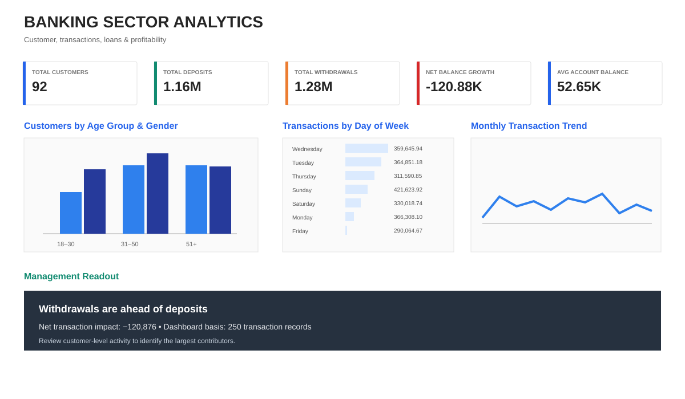
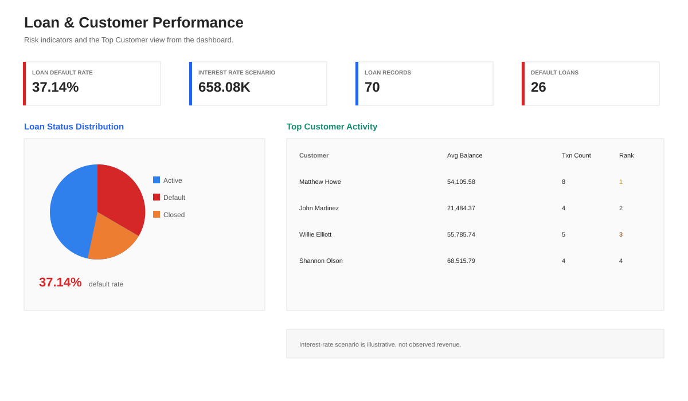
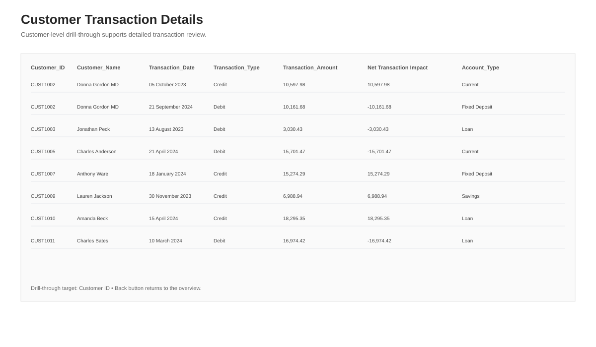

<h1>🏦 BANKING ANALYTICS — MANAGEMENT BRIEF</h1><b>Day 04 · Customer, transaction and loan exploration</b>

## Executive figures
| Source rows | Customers | Average balance |
|---:|---:|---:|
| 250 | 92 | 52,646.45 |

| Transaction measure | Amount |
|---|---:|
| Credits | 1,161,613.89 |
| Debits | 1,282,489.51 |
| Net credit minus debit | -120,875.62 |
| Records below 5,000 balance | 10 |

## Loan status register
| Status | Records |
|---|---:|
| Active | 25 |
| Default | 26 |
| Closed | 19 |
| Blank | 180 |
| Total loan records | 70 |

Default rate among nonblank loan statuses: **37.14%** (26 of 70). Blank statuses are not classified into a known status.

## Report preview gallery
| Overview | Loan performance | Transactions |
|---|---|---|
|  |  |  |
Conceptual SVG previews, not Power BI screenshot exports.

## Deliverables
[Power BI dashboard](Banking_Sector_Analytics_Dashboard.pbix) · [Source CSV](Banking_Data.csv) · [Insight presentation](Banking_Sector_Analytics_Insight_Summary_FINAL.pptx) · [Project PDF](Day4_Banking_Sector_Analysis.pdf)

The dataset spans 2023-09-24 to 2025-09-09. Credit/debit totals are dataset indicators, not independently verified cash-flow statements. Review missing loan statuses before decisions.