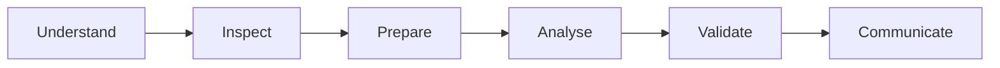

<b>Four business exercises · Multiple tools</b>

## Challenge selector
| 
🍔 DAY 01
 | 
⚡ DAY 02
 |
|---|---|
| **Food delivery** · SQL / MySQL | **Household energy** · Excel |
| [Enter challenge →](Day-01-SQL-Food-Delivery-Analysis/) | [Enter challenge →](Day-02-Household-Energy-Consumption-Analysis/) |
| 
🏭 DAY 03
 | 
🏦 DAY 04
 |
| **Quality control** · Power BI / DAX | **Banking sector** · Power BI / DAX |
| [Enter challenge →](Day-03-Quality-Control-Defect-Analysis/) | [Enter challenge →](Day-04-Banking-Sector-Analytics/) |

## Challenge lifecycle

## Tool coverage
   

## BI evidence guide
[Power BI Evidence Capture Guide](POWER_BI_EVIDENCE_CAPTURE_GUIDE.md)

SVGs in BI folders are conceptual layout previews, not screenshots exported from Power BI Desktop. Each challenge folder contains its own detailed guide and deliverables.

| Day | Primary deliverables |
|---|---|
| 01 | SQL analysis and project PDF |
| 02 | Excel workbook, verification notes and helper |
| 03 | PBIX and conceptual preview |
| 04 | PBIX, CSV, PDF and insight presentation |

Findings are specific to supplied challenge data, not industry benchmarks or proof of causation.