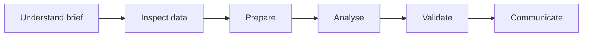

<h3>FOUR BUSINESS CASES · FOUR DIFFERENT TOOL PATHS</h3>

## Choose your case
<table><tr><td align="center" width="50%"><h1>🍔</h1><b>DAY 01 / FOOD DELIVERY</b> SQL · MySQL <a href="Day-01-SQL-Food-Delivery-Analysis/">ENTER CASE ↗</a></td><td align="center" width="50%"><h1>⚡</h1><b>DAY 02 / HOUSEHOLD ENERGY</b> Excel <a href="Day-02-Household-Energy-Consumption-Analysis/">ENTER CASE ↗</a></td></tr><tr><td align="center"><h1>🏭</h1><b>DAY 03 / QUALITY CONTROL</b> Power BI · DAX <a href="Day-03-Quality-Control-Defect-Analysis/">ENTER CASE ↗</a></td><td align="center"><h1>🏦</h1><b>DAY 04 / BANKING</b> Power BI · DAX <a href="Day-04-Banking-Sector-Analytics/">ENTER CASE ↗</a></td></tr></table>

## Analyst workflow

## Tool badges
   

## BI evidence status
[Power BI Evidence Capture Guide](POWER_BI_EVIDENCE_CAPTURE_GUIDE.md)

The Day 03 and Day 04 SVGs are conceptual layout previews, not screenshots exported from Power BI Desktop. Each challenge folder contains its own guide and deliverables.

| DAY | DELIVERABLE SET |
|---|---|
| 01 | SQL analysis + assignment PDF |
| 02 | Excel workbook + verification notes |
| 03 | PBIX + conceptual preview |
| 04 | PBIX + CSV + PDF + insight presentation |

All findings are limited to the supplied challenge datasets.